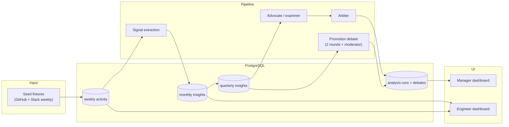

# PRFRD

PRFRD is a working prototype of an evidence-grounded engineering intelligence app. It turns weekly GitHub and Slack activity into monthly and quarterly signals, then produces manager-facing analysis where every claim is tied to a stored evidence reference.

The design goal is restraint: qualitative assessments, explicit uncertainty, no peer rankings, and no automated compensation decisions.

> **Status:** prototype. The analysis pipeline, database schema, guardrails, and dashboards are implemented. Ingestion currently runs from seeded fixtures. See [Current limitations](#current-limitations).

## What works today

- Weekly GitHub and Slack activity modeled in PostgreSQL with Drizzle
- Monthly and quarterly signal extraction with schema-validated LLM output
- Advocate / examiner / arbiter analysis flow with evidence-reference validation
- Guardrails against peer comparison, compensation language, and overconfident claims
- Manager dashboard with team rollups, risk flags, and engineer drill-downs
- Engineer dashboard with weekly activity, monthly summaries, and report generation
- Two-round promotion debate: advocate and examiner argue from one evidence catalog, streamed live to the manager
- Moderator readiness signal (`strong_case`, `mixed`, `not_yet`, `insufficient_evidence`) with open questions and what would change it
- Manager analysis and promotion debate turns persisted for audit
- Slack delivery helpers for agent updates

## Current limitations

These are known and intentional for the prototype stage:

- **Ingestion is simulated.** `npm run db:seed` loads realistic fixtures into the same tables a real collector would write to. There are no GitHub or Slack API clients yet.
- **Dashboards read fixtures.** The dashboard data layer reads the seed module directly instead of querying PostgreSQL. The analysis and manager-profile pages do read persisted rows.
- **Insight generation is single-pass.** Monthly and quarterly summaries are produced by one structured call each. The promotion debate is the only multi-turn agent loop.
- **The promotion debate needs persisted insights.** It reads the latest quarterly synthesis and its months; when those rows are missing the API returns a `409` instead of inventing context.
- **The moderator does not decide anything.** It returns a readiness signal so the manager can judge the case. No promotion, bonus, or compensation decision is automated.
- **No auth, tests, or CI yet.** Do not deploy this publicly as-is.

## Stack

- Next.js 16 (App Router) and React 19
- Vercel AI SDK with OpenAI models
- PostgreSQL (Neon serverless driver) and Drizzle ORM
- Tailwind CSS v4 and shadcn-style primitives

## Architecture



### Analysis flow

1. Weekly rows are grouped into months and quarters.
2. Each period is normalized and sent to a structured extraction pass with data-sufficiency scoring.
3. The manager analysis builds an evidence catalog (`E1`, `E2`, ...) from monthly and quarterly artifacts.
4. Advocate and examiner assessments are generated from the same evidence, followed by an arbiter decision.
5. Outputs are validated with Zod, checked against the evidence catalog, and persisted.
6. Managers can start a promotion debate on demand. Round 1 is independent opening cases, round 2 is a direct rebuttal, and a moderator synthesizes the strongest argument on each side without picking a winner.
7. Debate turns stream to the manager as NDJSON events and are written to `analysis_debate_turn` before the next turn starts.

### Promotion debate

The debate is a real agent loop, not one prompt with two voices:

- Both agents receive the same evidence catalog and a `lookupEvidence` tool, but opposite objectives.
- Round 2 requires each agent to answer the opponent's strongest point, concede what is valid, and add at most one new piece of evidence.
- The moderator returns `strong_case`, `mixed`, `not_yet`, or `insufficient_evidence`, plus the strongest arguments, open questions, and what additional evidence would change the assessment.
- Coverage still wins: `insufficient` data forces `insufficient_evidence` and low confidence, and `partial` data caps confidence at medium.
- The stop button aborts the run; the `analysis_run` row is marked `canceled` and completed turns remain readable.

### Guardrails

- Every claim must reference a known evidence ID
- Peer comparisons and team averages are rejected
- Compensation language is rejected in employee-facing prompts
- Confidence is downgraded when coverage is partial or insufficient
- Numeric performance scores are not produced
- The debate moderator never issues a promotion verdict; it returns a readiness signal for the manager

## Setup

```bash
npm install
cp .env.example .env.local
# fill in DATABASE_URL and OPENAI_API_KEY

npm run db:push
npm run db:seed
npm run dev
```

Open [http://localhost:3000](http://localhost:3000).

## Commands

| Command | Description |
| --- | --- |
| `npm run dev` | Start the local dev server |
| `npm run build` | Production build (works without secrets) |
| `npm run start` | Run the production build |
| `npm run lint` | ESLint |
| `npm run typecheck` | TypeScript, no emit |
| `npm run db:generate` | Generate Drizzle migrations |
| `npm run db:push` | Apply schema to the database |
| `npm run db:seed` | Load the full fixture dataset |
| `npm run db:seed:eve` | Add or update the Eve persona only |

## Generate analysis

```bash
curl -sS -X POST http://localhost:3000/api/insights/generate-report \
  -H 'Content-Type: application/json' \
  -d '{"employeeEmail":"alice@company.com"}'
```

```bash
curl -sS -X POST http://localhost:3000/api/insights/generate-manager-analysis \
  -H 'Content-Type: application/json' \
  -d '{"employeeEmail":"alice@company.com","quarter":"2025-Q4","monthKeys":["2025-10","2025-11","2025-12"]}'
```

## Run a promotion debate

```bash
curl -N -X POST http://localhost:3000/api/agents/promotion-debate \
  -H 'Content-Type: application/json' \
  -d '{"employeeEmail":"alice@company.com"}'
```

The response is newline-delimited JSON. Events are `run_started`, `turn_started`, `delta`, `tool_call`, `tool_result`, `turn_completed`, `summary`, `run_completed`, and `error`. Omit `quarter` to use the latest stored quarter.

Read the latest persisted debate:

```bash
curl -sS "http://localhost:3000/api/agents/promotion-debate?employeeEmail=alice@company.com"
```

## Roadmap

- Replace seed fixtures with real GitHub and Slack collectors and an incremental sync
- Move dashboard reads onto Drizzle query services
- Extend the tool-calling agent loop to monthly and quarterly insight generation
- Add durable, resumable analysis runs with human approval before delivery
- Add an eval harness for citation validity, unsupported claims, and bias leakage
- Add auth, rate limiting, tests, and CI

See [`docs/insights-sequential-runbook.md`](docs/insights-sequential-runbook.md) for manual insight generation.

## License

MIT
