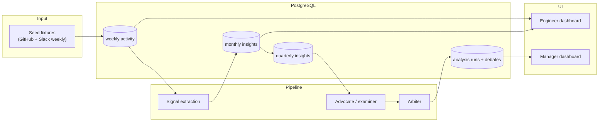

# PRFRD

PRFRD is a working prototype of an evidence-grounded engineering intelligence app. It turns weekly GitHub and Slack activity into monthly and quarterly signals, then produces manager-facing analysis where every claim is tied to a stored evidence reference.

The design goal is restraint: qualitative assessments, explicit uncertainty, no peer rankings, and no automated compensation decisions.

> **Status:** prototype. The analysis pipeline, database schema, guardrails, and dashboards are implemented. Ingestion currently runs from seeded fixtures. See [Current limitations](#current-limitations).

## What works today

- Weekly GitHub and Slack activity modeled in PostgreSQL with Drizzle
- Monthly and quarterly signal extraction with schema-validated LLM output
- Advocate / examiner / arbiter analysis flow with evidence-reference validation
- Guardrails against peer comparison, compensation language, and overconfident claims
- Manager dashboard with team rollups, risk flags, and engineer drill-downs
- Engineer dashboard with weekly activity, monthly summaries, and report generation
- Manager analysis and debate transcripts persisted for audit
- Slack delivery helpers for agent updates

## Current limitations

These are known and intentional for the prototype stage:

- **Ingestion is simulated.** `npm run db:seed` loads realistic fixtures into the same tables a real collector would write to. There are no GitHub or Slack API clients yet.
- **Dashboards read fixtures.** The dashboard data layer reads the seed module directly instead of querying PostgreSQL. The analysis and manager-profile pages do read persisted rows.
- **Generation is single-pass.** Each period is produced by one structured `generateText` call, not a multi-step agent loop.
- **The debate view is persisted, not streamed.** Responses are read from `analysis_debate_response` when the sheet opens.
- **No auth, tests, or CI yet.** Do not deploy this publicly as-is.

## Stack

- Next.js 16 (App Router) and React 19
- Vercel AI SDK with OpenAI models
- PostgreSQL (Neon serverless driver) and Drizzle ORM
- Tailwind CSS v4 and shadcn-style primitives

## Architecture



### Analysis flow

1. Weekly rows are grouped into months and quarters.
2. Each period is normalized and sent to a structured extraction pass with data-sufficiency scoring.
3. The manager analysis builds an evidence catalog (`E1`, `E2`, ...) from monthly and quarterly artifacts.
4. Advocate and examiner assessments are generated from the same evidence, followed by an arbiter decision.
5. Outputs are validated with Zod, checked against the evidence catalog, and persisted.

### Guardrails

- Every claim must reference a known evidence ID
- Peer comparisons and team averages are rejected
- Compensation language is rejected in employee-facing prompts
- Confidence is downgraded when coverage is partial or insufficient
- Numeric performance scores are not produced

## Setup

```bash
npm install
cp .env.example .env.local
# fill in DATABASE_URL and OPENAI_API_KEY

npm run db:push
npm run db:seed
npm run dev
```

Open [http://localhost:3000](http://localhost:3000).

## Commands

| Command | Description |
| --- | --- |
| `npm run dev` | Start the local dev server |
| `npm run build` | Production build (works without secrets) |
| `npm run start` | Run the production build |
| `npm run lint` | ESLint |
| `npm run typecheck` | TypeScript, no emit |
| `npm run db:generate` | Generate Drizzle migrations |
| `npm run db:push` | Apply schema to the database |
| `npm run db:seed` | Load the full fixture dataset |
| `npm run db:seed:eve` | Add or update the Eve persona only |

## Generate analysis

```bash
curl -sS -X POST http://localhost:3000/api/insights/generate-report \
  -H 'Content-Type: application/json' \
  -d '{"employeeEmail":"alice@company.com"}'
```

```bash
curl -sS -X POST http://localhost:3000/api/insights/generate-manager-analysis \
  -H 'Content-Type: application/json' \
  -d '{"employeeEmail":"alice@company.com","quarter":"2025-Q4","monthKeys":["2025-10","2025-11","2025-12"]}'
```

## Roadmap

- Replace seed fixtures with real GitHub and Slack collectors and an incremental sync
- Move dashboard reads onto Drizzle query services
- Replace single-pass generation with a tool-calling agent loop and streamed UI
- Add durable, resumable analysis runs with human approval before delivery
- Add an eval harness for citation validity, unsupported claims, and bias leakage
- Add auth, rate limiting, tests, and CI

See [`docs/insights-sequential-runbook.md`](docs/insights-sequential-runbook.md) for manual insight generation.

## License

MIT
